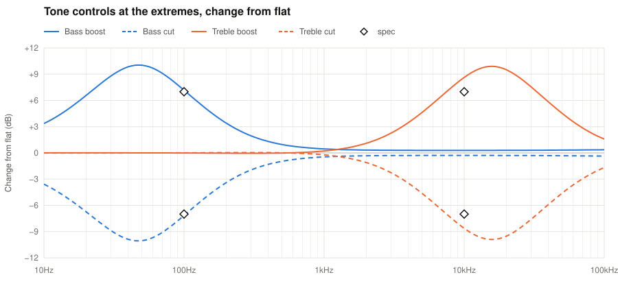

# schem2spice

Turn a scanned hi-fi service manual into a working circuit simulation.

schem2spice reads the schematic pages of a scanned service manual, recognises the
symbols, labels and wires, completes part values from the manual's parts list, and
writes a SPICE netlist that ngspice simulates. The DC voltages printed on the
schematic are the ground truth: every board is checked against them, and the whole
signal chain can be checked against the published specifications (gain, frequency
response, tone range, RIAA accuracy, input impedance).

It was built on the Marantz PM-80 Mk II integrated amplifier, which is included
as the reference project, and is meant for any similar manual.

```
PDF scan ─ ingest ─ detect ─ ocr ─ trace ─► IR (JSON) ─ corrections ─ bom ─ netlist ─ ngspice ─ validate
            pages    symbols  labels  nets                human fixes  parts list            printed voltages
                                                                                             published specs
```

Everything runs locally: template matching and classical line tracing (OpenCV),
RapidOCR for text, ngspice for simulation. No cloud services.

## Quick start

```sh
git clone https://github.com/babacool2015/schem2spice && cd schem2spice
make install     # ngspice (Homebrew or apt), Python venv, OCR models, then a check
make test        # engine tests; tests that need a manual skip themselves
```

Requirements: macOS or Linux, Python 3.11+, and ngspice (installed by `make tools`).
`make doctor` reports what is missing and how to fix it.

## Bring your own manual

Service manuals are copyrighted, so none is distributed here. Each manual is a
**project** folder:

```
projects/<name>/
  project.yaml     manual-specific settings: PDF + hash, sales variant, parts-list format
  crops.yaml       named page regions (one board or module each)
  corrections/     human fixes per crop: status proposed (unchecked) or confirmed
  testbenches/     supply rails, cut-off circuits, switch and pot positions per board
  systems/         boards chained input jack to speaker, with spec checks
  data/ pages/ out/   your PDF, extracted pages, generated output (git-ignored)
```

```sh
.venv/bin/schem2spice init-project my-amp --pdf ~/manuals/my-amp.pdf
make ingest PROJECT=projects/my-amp
```

Then follow [docs/new-project.md](docs/new-project.md): name crops, extract, review,
correct, add parts-list values, write a testbench, simulate. Commands find the
project from `--project DIR`, `$S2S_PROJECT`, or the folder you run them in.

## The reference project: Marantz PM-80 Mk II

[projects/marantz-pm80mk2](projects/marantz-pm80mk2/README.md) covers six boards
(phono/input, volume, tone, balance, power amp, power supply), about 600 parts.
Put your copy of the manual in its `data/` folder to run the full test suite
(`make test-all`). Chained from input jack to an 8 Ω load, the extracted circuit
meets 13 of 16 published specifications:

| Spec | Simulated | Published |
|---|---|---|
| CD/line gain (170 mV → 100 W / 8 Ω) | 44.20 dB | 44.42 dB |
| Frequency response 10 Hz / 100 kHz | +0.20 / −0.11 dB | −1 dB |
| MM phono gain (2.8 mV), RIAA accuracy | 79.66 dB, ±0.13 dB | 80.07 dB, ±0.3 dB |
| MC phono gain (220 µV), input impedance | 102.17 dB, 100 Ω | 102.17 dB, 100 Ω |
| Bass / treble at 100 Hz / 10 kHz | ±7.17 / ±8.6 dB | ±7 dB |
| Line input impedance | 76 kΩ | 20 kΩ |



It also found a parts-list misprint: the phono input chokes are 320 µH, not the
listed 320 mH, which a photo of a real board confirmed.

## Documentation

- [docs/new-project.md](docs/new-project.md): reverse-engineer a new manual, step by step
- [docs/corrections.md](docs/corrections.md): the review and correction workflow
- [CLAUDE.md](CLAUDE.md): engine conventions and the rules learned so far (also read by Claude Code)

## Copyright

No manual content is distributed: PDFs, page images and outputs stay in each
project's git-ignored folders, and `project.yaml` records the scan's SHA-256 so
you can check that you have the same one. The symbol templates in `symbols/templates/`
are small crops of single schematic symbols, used only as detection patterns.

## License

MIT, see [LICENSE](LICENSE).
