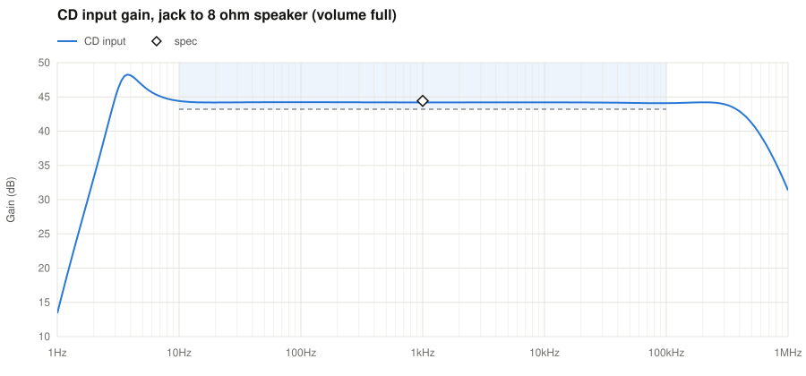
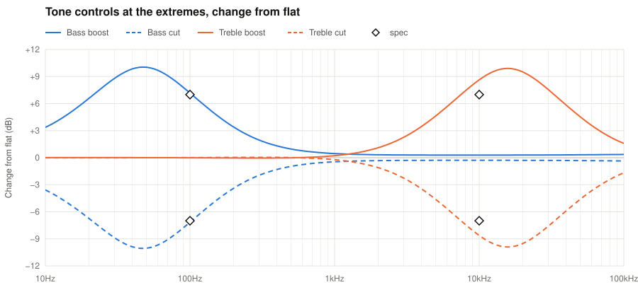
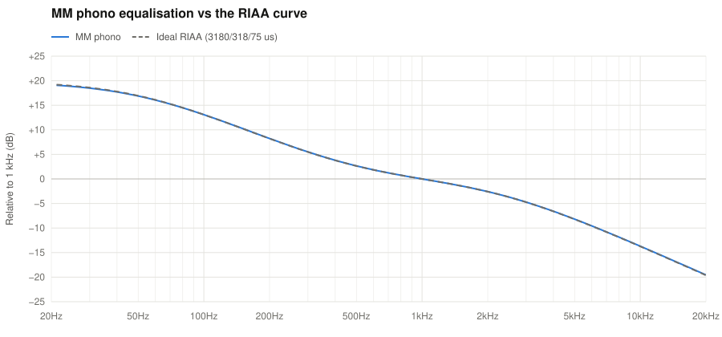
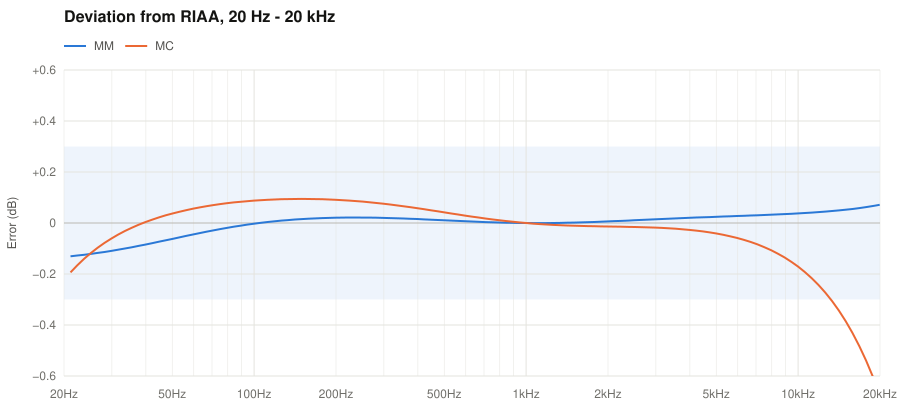

# Marantz PM-80 Mk II

The reference project of schem2spice: the PM-80 Mk II integrated amplifier, from its
Philips/Marantz service manual. Six boards are extracted from the scan, simulated
against the printed DC voltages, and chained input jack to speaker against the
published specifications.

**The manual is not included.** Put your copy at
`data/Marantz-PM-80-Mk2-Service-Manual.pdf` (`project.yaml` has the SHA-256 of the
scan this was built on), then:

```sh
make ingest          # from the repo root: pages/page-NN.png
make test-all        # every test, including extraction and simulation of all boards
make chain           # out/sys/chain_report.md + frequency responses
```

Commands below run from this folder (or pass `--project projects/marantz-pm80mk2`).
The user's unit, and `variant` in project.yaml, is 22B.

## Results

Chained P401 → P501 → P601 ↔ P651 → P701 into 8 Ω (volume full, balance centre),
13 of 16 published specifications are met; the chain's DC point matches 142 of 162
printed voltages, as the boards alone do.

| Spec (PDF 3) | Simulated | Published |
|---|---|---|
| Line gain, 170 mV → 100 W / 8 Ω | 44.20 dB | 44.42 dB |
| Response 10 Hz / 100 kHz | +0.20 / −0.11 dB | −1 dB |
| Bass at 100 Hz | ±7.17 dB | ±7 dB |
| Treble at 10 kHz | **±8.6 dB** | ±7 dB |
| MM gain, 2.8 mV | 79.66 dB | 80.07 dB |
| RIAA accuracy | ±0.13 dB | ±0.3 dB |
| MM input impedance | 46.7 kΩ | 47 kΩ |
| MC gain, 220 µV | 102.17 dB | 102.17 dB |
| MC input impedance | 100 Ω | 100 Ω |
| Line input impedance | **76 kΩ** (117 kΩ at minimum volume) | 20 kΩ |

Simulated responses (left channel; `make chain` regenerates them in `out/sys/`, copies
here in `docs/`):






Findings:
- **L401/L402** (phono input chokes): the parts list prints 320 mH; the circuit only
  meets the RIAA and MC specs with 320 µH, and a photo of a real board shows small
  drum-core chokes. Confirmed by the owner (2026-11-16).
- **Line input impedance**: the CD input sees R427 220k ∥ the volume track ∥ R501
  220k. With the listed 250 kΩ volume pot that is 76–117 kΩ; a 25 kΩ pot would give
  20–22 kΩ, matching the spec. Open: an ohmmeter between the CD jack's tip and
  sleeve (power off, selector on CD, volume minimum) reads about 22 kΩ or 117 kΩ.
- **Treble ±8.6 dB** vs ±7: unexplained (C623 read as 180p instead of the list's
  100p makes it worse).
- Known model deviations: output-stage bias points 0.69 V vs 0.60 V printed (PM11/
  PM21), P701 input-pair bases (2SC3067 hFE unknown), NJM2068 offsets.

## The manual
- The PDF is a **raster scan**: 1-bit CCITT, no fonts, no text layer. Schematic pages are 7015x9921 px (600 ppi); text pages are 3507x2480 (300 ppi).
- Extract pages losslessly with `schem2spice ingest` (PyMuPDF) -> `pages/page-NN.png`. Do not re-render through a lossy path. (poppler/`pdfimages` does not build on this Intel macOS 15 machine via Homebrew.)
- Every page has `/Rotate 90`; `ingest` applies it with a lossless transpose, so `pages/` PNGs are upright (sheets 9921x7015, text pages 2480x3507).
- **Page numbering**: "p." in this file means the **printed** manual page. Tools (`--page`, `pages/page-NN.png`) use the **PDF** page. Each fold-out sheet holds two printed pages:

  | PDF | Printed | Content |
  |---|---|---|
  | 1-2 | - | Cover, contents, ordering info, addresses |
  | 3 | 1/2 | Block diagram, specifications |
  | 4 | 3/4 | Schematic: P401 phono/input, P501 volume (PM11/21/31/41) |
  | 5 | 5/6 | PCB layouts: P401, P501, PM11/21/31/41 |
  | 6 | 7/8 | Schematic: P601 tone amp (part 1/2), P651; PCB layouts P601, P651 |
  | 7 | 9/10 | Schematic: P701 power amp (first part) |
  | 8 | 10/11 | Schematic: P701 power amp (continued) + PCB layout |
  | 9 | 12/13 | Schematic + PCB layouts |
  | 10 | 13/14 | Schematic + PCB layouts |
  | 11 | 15/16 | Exploded view and mechanical parts list |
  | 12 | 17/18 | Test equipment, idling current, voltage conversion |
  | 13-17 | 19-23 | Electrical parts list; common-parts code legend on PDF 13 |
- Sheets are **not all drawn at one scale**: PDF 6 is drawn 1.26x PDF 4 (template-scale sweep peak; strokes 4.65 vs 3.8 px). A crop's `scale:` in `crops.yaml` shrinks it to PDF-4 scale before detect/ocr/trace (all thresholds were set there); `to_ir` maps boxes back to page px, so corrections stay in page coordinates.
- Schematic sheets are **split across pages** (printed pp. 9/10/11 = PDF 7-8, 12/13/14 = PDF 9-10) and partly **duplicated** where printed pages overlap. Stitch and de-duplicate before extracting connectivity.
- The design is **hierarchical**: boards (P401, P501, P601, P701, P851...) contain modules (PM11/21/31/41) and connect through labelled connectors ("To P601 (J602)", WK0xx).
- Many R/C values are **not on the schematic** (common-parts codes "R***", "C***"). The parts list (pp. 19-23) and the code legend (p. 19) complete them.
- Printed DC voltages on the schematic are the **ground truth** for validation.

## Boards and commands
- Back end (works now): `schem2spice sim --ir golden/pm11/ir.json --tb golden/pm11/testbench.yaml --name pm11` -> `out/pm11.cir`, `out/pm11_validate.md`.
- End to end: `extract --crop p501l` -> `bom --ir out/p501l_extracted.json` -> `sim --ir out/p501l_bom.json --tb golden/pm11/testbench.yaml --name p501l`.
- P401: `extract --crop p401l` -> `bom --ir out/p401l_extracted.json --variant 22B` -> `sim --ir out/p401l_bom.json --tb testbenches/p401l.yaml --name p401l`. Testbenches beyond the pilot live in `testbenches/`. `bind:` gives a part a pin the crop does not show (Q401-1's V- is drawn on Q401-2). The user's unit is variant 22B.
- P401 both channels: `extract --crop p401` -> `bom --ir out/p401_extracted.json --variant 22B` -> `sim --ir out/p401_bom.json --tb testbenches/p401.yaml --name p401`. The right channel's input runs through the left's area (J401, L402, S403), so the channels are extracted together; `corrections/p401.yaml` has `include: [p401l]`. Testbench `cut:` groups may give `region: [x0, y0, x1, y1]` (page px) for parts OCR never named (the CD/TUNER/AUX jacks).
- Front end (works now): `schem2spice extract --crop pm11 --golden golden/pm11/ir.json` -> `out/pm11_extracted.json`, `out/pm11_trace.png` (net overlay) and a diff against golden. Crops are named in `crops.yaml` (rect on the upright PDF page). `--score X0 Y0 X1 Y1` limits scoring when the crop is wider than the golden scope (`p501l`: `--score 6250 650 9150 2500`).
- Review: `schem2spice review --crop p501l` -> `out/p501l_review.html` (scan thumbnail, reasons and correction on file for each part needing a look). Corrections live in `corrections/<crop>.yaml`, match detections by type + page position (within 40 px), and are applied by `extract`: `status: confirmed` always, `status: proposed` (read off the scan by Claude, unchecked) only with `extract --proposed`.
- New symbols (page 4, P401): `opamp` (one section of a dual; the undrawn supply pin is taken from the sibling section, e.g. Q401-1 V- from Q401-2), `inductor`, `switch_spdt` (one pole; testbench param `<base ref>: drawn | other`, "drawn" = C-2 closed), `rca_jack` (sockets of one jack block become one connector J401 with pins T1/S1/T2/S2; the box around them is erased but crossing wires kept). Each template is cut from one copy and tested on an unseen twin (Q401-2 -> Q401-1, L402 -> L401, J402 -> J401).
- P501 both channels: `extract --crop p501` -> `bom --ir out/p501_extracted.json --variant 22B` -> `sim --ir out/p501_bom.json --tb testbenches/p501.yaml --name p501`. `corrections/p501.yaml` has `include: [p501l]`. Keep the crop's left edge at x=6250: at 6150 it runs along J501's box outline, which shorts the jack's pin wires.
- P601: `extract --crop p601` -> `bom --ir out/p601_extracted.json --variant 22B` -> `sim --ir out/p601_bom.json --tb testbenches/p601.yaml --name p601`.
- P701: `extract --crop p701` -> `bom --ir out/p701_extracted.json --variant 22B` -> `sim --ir out/p701_bom.json --tb testbenches/p701.yaml --name p701`. PDF 7 holds the whole amplifier (both channels, scale 1.26); PDF 8 repeats only the protection/relay side, so no stitching was needed for the amp.
- P851: `extract --crop p851` -> `bom --ir out/p851_extracted.json --variant 22B` -> `sim --ir out/p851_bom.json --tb testbenches/p851.yaml --name p851`. The board is drawn whole on both PDF 9 and PDF 10; the crop uses PDF 10 and every new template was tested on the PDF 9 copy.
- New symbols (page 10, P851): `darlington_pnp` (Q854 2SB1022), `regulator` (Q855 NJM78M24A, pins IN/OUT/GND, behavioral subckt), `rc_snubber` (G851 "0.47U+6.8", value "0.47u+6.8", emitted as C+R in series), a second drawing of `darlington` (Q853 upright: `darlington@2.png`, pins under `drawings:` in the library; detections carry the template stem), and `warning`, the safety mark (triangle with "!"), a non-component erased before tracing while straight wires through it are kept (`MARKS`; `warning@2` is the mark with a wire across its apex).
- New symbols (page 7, P701): `led` (D715 LT3D8B), `darlington` (Q719 2SD1508, X subckt), `photocoupler` (Q721 PC817, pins A/K/C/E, X subckt), `resistor_ct` (R781 "0.18X2": pins 1/M/2, emitted as two resistors of the per-half value). These are `CONTAINERS` in detect: a detection lying mostly inside one (the zigzag, the inner diode) is dropped. A dual transistor (Q701 2SC3067) is two `npn` halves named Q701-1 (input side) / Q701-2.
- Trace rules from P701: a pin's lead that runs straight on past a perpendicular wire with no dot crosses it (`_drop_crossings`), and so does a wire end whose stroke continues across a through wire in the scan (`_hidden_crossing`); pins of two parts drawn lead to lead within 30 px on one stroke are joined (`_touching_pins`); collinear wires <= 6 px apart are one wire (`DROP_TINY`, hairline print breaks, some made by the 1/1.26 resample).
- Trace rules from P851: two wires meet only if any gap between them wider than 3 px is inked (`_inked_meeting`; the "1" of "R851 1" stood between two lines within END_TOL); a pin joins a connector stack it sits next to, then stacks are sorted along their axis (a horizontal header with pin 1 drawn 2 px lower was split).
- Detection thresholds lowered on P701 evidence, each checked for new hits on p501/p401/p601/p701: resistor 0.72 (R736 0.746, text against its zigzag), capacitor_polarized 0.70 (CN05 0.722, drawn smaller).
- Detection: connector_pin threshold 0.70 (P501 J505: the dashed board outline crosses its pin circles, 0.72-0.76; no other new hit on p501/p401/p601).
- System chain (input jack to speaker): `system --file systems/chain.yaml [--build]` -> `out/sys/chain_report.md`, `out/sys/<case>_response.csv`. `--build` first rebuilds each board's IR from the scan with proposed corrections into `out/sys/` (`cli.build_ir`); `out/` keeps the confirmed-only outputs. The system file lists boards (IR + own testbench: rails, cuts, params stay), `links` (connector wiring, `p401x:J408.1` = `p501:R529-2.2`), extra `ground` pins, `loads`, and `cases` (params, AC sources, spec checks: `gain`, `flat`, `zin`, `relative`, `riaa`). Nets and refs are prefixed with the board (`p501_n12`, `Rp501_R501`); board sources/loads on linked nets are dropped and reported. The DC operating point of the chain is validated against every board's printed voltages (142/162, the same as the boards alone).
- Boards in the chain: `p401x` (p401 + input selector S401-1/-2 + line jacks; crop to y=5310, the gap between wires below S401; jack block cut by region, CD terminations R427/R428 kept with `keep:`), p501, p601, `p651` (balance, page 6), p701. Wiring: W005 J408 -> J501 pin for pin (1 L, 2 L gnd, 3 R gnd, 4 R; J501 lies outside the p501 crop, its pins 1/4 are the R529-2/-4 track ends), W008 J502 -> J602, W009 J603 <-> J651 pin for pin, W004 J601 -> J701 (R701/R702). Volume R529 position 1.0 = full. S401 position 1 PHONO ... 6 TAPE (2 = CD, drawn). S601 poles: 1-4 DIRECT, 5/6 SUBSONIC (R601/R602), 7/8 MONO (R603/R604). R625 BASS, R626 TREBLE, position 1 = boost. Balance R651: position 0 = wiper on the dead band = centre.
- Spec results (PDF 3, rated 100 W / 8 ohm = 28.28 V): line gain 44.20 dB vs 44.42 (170 mV); response +0.20 dB at 10 Hz, -0.11 dB at 100 kHz (spec -1 dB); bass +-7.17 dB at 100 Hz (+-7); MM 79.66 dB vs 80.07 (2.8 mV), RIAA within 0.13 dB (0.3), MM input 46.7 kohm (47k); MC 102.17 dB vs 102.17 (220 uV), MC input 100 ohm. Misses (`KNOWN_SPEC_MISSES`): line input impedance 76 kohm at full volume (117k at minimum; ~R501 220k || R529-2 250k || R427 220k, the drawn circuit has no 20 kohm path) and treble +-8.6 dB at 10 kHz vs +-7 (C623 read 180p instead of the list's 100p makes it worse, 9.55 dB).
- L401/L402 (phono input chokes): the parts list prints "320mH"; the chain shows it is 320 uH (with 320 mH: RIAA +5.1 dB at 12.6 kHz, MC 76 dB, MC input 2 kohm; with 320 uH all three meet the spec). Confirmed by the user (2026-11-16; board photo: small radial drum-core chokes) in `corrections/p401.yaml` with `over_list`.
- New symbol `rotary_pole` (S401, page 4): six terminal circles on an arc + common; throws numbered from the top-right circle = knob order; param `<base ref>: 1..6 | drawn`. Template cut from S401-1 (circles and wiper only), S401-2 unseen 0.862, S401-3/-4 0.75-0.77, nothing else on pages 4/6 above 0.4.
- New pot drawings `potentiometer@2/@3` (P651 R651-1/-2, balance with a conductive dead band drawn as a box): pin 1 at the box's outer end, not swapped by position (`swappable: []` per drawing). Both cut (R651-2 is mirrored with its zigzag rotated; the R651-1 drawing put its wiper on the wrong side); P651 appears once, no unseen copy; best other hit on pages 4/6/7/10 0.56.

## Pilot: PM11 amp module
PM11 (board YK188J195-0, on the P501 volume board, printed p. 4 = PDF page 4, right half): QM11/QM12 2SK369 (JFET), QM13/QM16 2SC2240, QM14/QM15 2SA970, diodes DM11-DM15 (1SS176), RM11/RM12 100 ohm 1%, RM13-RM16 carbon film (values on schematic). Parts list on printed p. 19 (PDF 13).

1. **Back end first**: hand-write `golden/pm11/ir.json` from the schematic, generate the netlist, run `.op`, compare with the printed voltages. This is the reference for everything after.
2. **Extraction**: run detect/ocr/trace on the PM11 crop and diff the resulting IR against the golden IR.
3. **Then scale**: P401 phono stage (NJM2068 + RIAA network) -> P501/P601 volume and tone -> P701 power amp -> P851 supply.

Done = simulated node voltages within tolerance of the printed ones (start with +/-10%, tighten later), and extracted IR equals golden IR on the pilot.

## Status
- detect (template matching, `symbols/templates/` cut from PM21/JM21) + ocr (RapidOCR, local) + trace (classical H/V) reproduce the golden PM11 IR: 46/46 pins, 11/11 printed voltages; with the P501 left channel 99/99 pins, 17/17 voltages. Thresholds were tuned on page 4, so P401 is the first unseen test.
- bom (parts list OCR + merge) gives the extracted PM11 exactly the golden values and tolerances; "2SA9701" -> 2SA970, ranks and diode values come from the list.
- Known gaps:
  - p501l needs 14 corrections (11 unread refs, 1 wrong ref R526->R525, R523 value, R529 sections); all are in `corrections/p501l.yaml`, confirmed by a human (2026-11-10). With them: bom 0 errors, all 41 golden parts match ref/value/tolerance by position.
  - OCR recall: fixed tiling removed the crop dependence; P501 scope still misses R529-1, R501, R521, C503 (`KNOWN_REF_MISSES` in tests/test_ocr.py).
  - Parts list rows after P701 (P801/P851/P901) have some refs OCR missed (`refs == []`, reported, not indexed).
- End-to-end pilot done: the IR extracted from the scan (crop p501l + confirmed corrections + bom) simulates to the same value as the golden IR at all 17 printed voltages; 13/17 within +/-10 %. The 4 misses are outh/outl (0.69 V vs 0.60 V printed), a model issue shared with golden (`KNOWN_DEVIATIONS` in `tests/test_sim.py`).
- P401 left channel (crop p401l, first unseen sheet): detect/trace clean (0 floating pins); 28 corrections in `corrections/p401l.yaml`, 25 confirmed by the user (2026-11-11). The 3 left `proposed` are voltage-label moves the user could not judge; simulation supports them (16.7 V: proposed net sims 16.66 V vs 0.00 V where it sits; -17.2 V sits on the module output, which sims 0.00 V; the 0 V one is harmless either way). Simulated with confirmed items only: 13/15 printed voltages within +/-10 %, the 2 misses being exactly those labels; with all 28: 15/15 (now covered by the two-channel test below).
- NJM2068 is a behavioral single-pole macromodel (`models/opamps.lib`, see map.yaml); S403 simulated in the drawn position (MM: R403/C403 MC load disconnected). The page draws the 22B/22G variant (L401/L402, C447 fitted); C401 is printed 220p but listed 330p (22B) / 100p (others).
- P401 both channels (crop p401): 112 parts, 0 floating pins. 21 more corrections proposed in `corrections/p401.yaml` (right channel: 11 unread refs, R408/R410 and R414/R416 swaps, RM43/C412 misread refs, RM45/RM46 values, 3 label moves mirroring the left; plus DM31 and RM33 = 68, which this wider crop misread as "89"). With all of them: 28/28 printed voltages within +/-10 %, and the two channels simulate alike (`test_extracted_p401_matches_printed_voltages` checks L/R twins). A misread common-part value still passes +/-10 %: compare channel twins.
- P601 tone amp (crop p601, page 6, second unseen sheet): 74 parts, 0 floating pins after scale normalization (8 parts before). 37 corrections proposed in `corrections/p601.yaml` (12 unread refs, 8 op-amp sections, 8 S601 poles numbered by position, 5 values, 4 labels), awaiting confirmation. With them: rails exact; 13/21 within +/-10 %; the 8 misses are near-zero points printed +0.03 V vs -0.02/-0.04 V simulated (NJM2068 bias current through 220k, unit offset not modelled), bounded at 0.1 V in `test_extracted_p601_matches_printed_voltages`. L/R channels and S601 pole pairs are symmetric.
- P501 both channels (crop p501): 86 parts, 0 floating pins. 17 right-channel corrections proposed in `corrections/p501.yaml` (7 unread refs, R529-4, 7 values, 3 labels: "-0.04V" read "F0.04V" and placed on a stub, "-0.02V" on the coupled output, and a misprinted "6.0V" at the Q502 base deleted). With them: bom 0 errors; 26/33 within +/-10 %; the 7 misses are the +/-0.6 V output-stage bias points (0.69 V simulated, the pilot's outh/outl deviation); L/R twins simulate alike (`test_extracted_p501_matches_printed_voltages`). The right channel's ground (R529-4, R502, R524...) joins nothing inside the crop (it leaves via J501); the testbench ties it to ground.
- Twin check: pairing each right-channel part with its left twin by the sheet offset (P501: dy = 1795 px) and requiring a consistent net mapping found the J505 and crop-edge faults; worth making a `review` check.
- P701 power amp (crop p701, page 7, both channels): 192 parts, 0 floating pins. 70 corrections proposed in `corrections/p701.yaml` (unread/wrong refs, Q701/Q702 halves, values, 4 schematic-over-list values, 11 voltage labels incl. the zener rating "3.6V" read as a voltage and a sign-less "0.3V"), awaiting confirmation. Testbench: rails driven where they enter (+56.7/-57.0 pre-driver, +58.0/-58.3 output), Class AB (photocoupler chain Q721/R749/R753/R759/R761 and twins cut), QN03 cut (its collector is set by the TA7317P), bias trimmers R751/R752 set by the manual's idling procedure (PDF 12 sec. 5: 18 mV across R781/R782 -> position 0.2125). Result: 75/80 within +/-10 %. Misses: input-pair bases (printed -0.3/-0.2 V vs -0.08 V; the printed values imply hFE ~150-225 for the 2SC3067, model has 400, no datasheet) and Q719/Q720 base (-0.67 vs -0.6 V, Darlington stand-in). L/R twins identical. Twin check by ref (odd = left, even = right) found the J505-like faults here too; rail parts (C715-C720, R789-R792) and RN/QN refs are not channel pairs.
- P701 parts list vs schematic: besides R789-R792, the list gives C701 100p (schematic 330p), C720 330u (220u), C703 2200p (470p), C707 5p (10p), D727-D730 RD5.6 zeners (schematic "3.6V"). The list wins for those (no printed voltage decides them). D719-D722 (RD20F) are in the list but not on this sheet.
- P601 supply (settled with P851): the raw +-18 V from P851 J854 (printed 18.4/-18.3 V) enters at the R627/R629 and R628/R630 nodes; the testbench drives those and simulates R627-R630. The parts list (470/220 ohm) is right and the schematic's "100" is not: the printed drops 1.9 V (R627, one NJM2068) and 2.5 V (R629, three) are in the ratio 1 : 1.32, as 470 : 3 x 220 = 1 : 1.40 predicts for equal current per package (~4 mA); 100/100 would give 1 : 3. Rails simulate 16.05/-15.95/15.1/-15.0 V vs 16.5/-16.3/15.9/-15.8 printed (the model's NJM2068 draws ~2.5 mA per section, the board implies ~2).
- P851 power supply (crop p851, PDF 10): 74 parts, 0 floating pins. 42 corrections proposed in `corrections/p851.yaml` (bridge diode refs, the new symbols, values, R869 10k, 5 labels: four zener ratings "20.0V"/"7.5V"/"9.5V" read as voltages, -18.4V moved to Q854.E), awaiting confirmation. Testbench: AC side and the power-off detector (its input is the AC peak) cut, raw rails driven (+-31.0, 30.2, 56.7/-57.0 V), P601's ~20 mA as the +-18 V load. Result: 15/15 within +/-10 % (10 real checks, 5 driven rails); +-18 V outputs 18.86/-18.88 V vs 18.4/-18.3 printed (zener model 20.1 V vs the board's 19.7 V). The power-off detector's -52.4 V is not simulated.
- NJM2068 model: output limiting is behavioral (no path between the supply pins). The first version's rail-referenced clamp diodes gave a false collapsed-rails operating point when fed through a resistor.
- Print dropouts: the -17.2 V rail and output wire under PM41 are broken in the scan. `trace` bridges a gap only between two collinear pieces each >= 100 px (longer than any dash) with ink specks inside the gap (not at its corner ends), no crossing wire and no symbol inside (`_dropout_bridges`).
- On P401, PM31's outputs (J406 pins 4 and 5) are tied by a drawn junction dot (no buffer pair as on P501): not a trace error.
- Extracted PM11 alone is open loop (feedback is on P501), so it is checked by value/net diff, not simulated.
- Scan finding: the left channel's +15.1 V net (J504.3 - Q501.C) has no drawn junction to the R525 rail on PDF page 4 (the right channel's Q502.C does). Trace is faithful; the testbench drives that net, as the golden cut already did.
